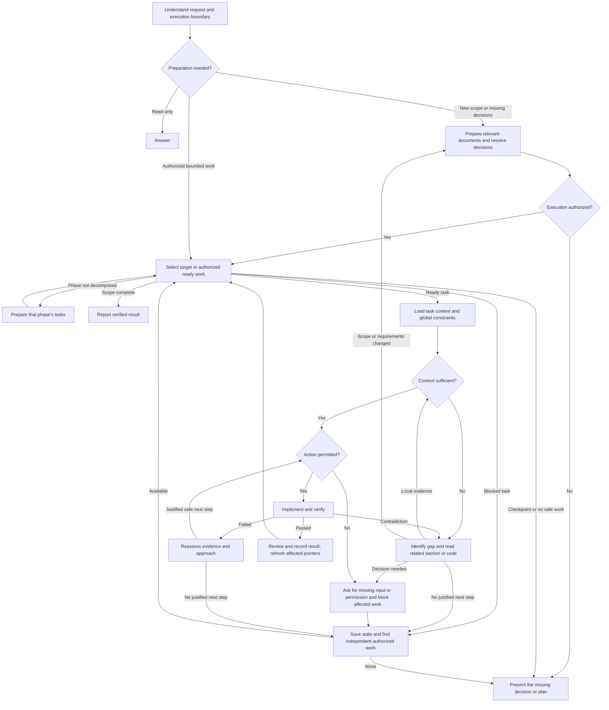

# One working workflow

AGENTS supplies the universal rules. This file owns transitions and recovery.
The planning skill owns document structure; other skills perform their bounded job
and return here. No separate mode catalog or extra tracking documents are required.

## Flow

## Transition rules

| Event | Action |
|---|---|
| Entry/resume | Use AGENTS's task-entry reading order and relevant MEMORY. Recover scope, checkpoints and pending questions; read DESCRIPTION when the idea or requirements need clarification |
| Bounded authorized work | Use the existing task/request and relevant checks; do not bootstrap four documents or require a special exemption |
| New requirements/architecture/scope | Prepare affected documents using planning. Ask only material unanswered questions; resolve missing approval before dependent implementation |
| Start execution | An explicit execution instruction is sufficient, including “approved, execute”; preserve its scope and checkpoints |
| Activate a phase | Decompose its outcome before code. Its declared preceding phases must be verified; a later phase with After: none explicitly permits independent work |
| Select work | Prefer the requested task; otherwise first ready in row order. Check task and phase prerequisites. If the target is blocked, explain and select authorized ready prerequisites or independent work; retain the target for resumption |
| Context gap or contradiction | Name the missing behavior, constraint, interface, or verification fact; inspect the related source and callers/tests. Repair stale pointers by targeted search. Ask only for a material decision unavailable from evidence; block affected work |
| Insert work | In-scope necessary work joins the right position. If it is a prerequisite, update dependent After fields. Put new product ideas in Proposals |
| Before each action | Respect scope, permission, and checkpoints. See SECURITY for operation effects; missing permission is not a failed check |
| Successful task | Review and record evidence, update Current and affected pointers, consider eligible MEMORY, and continue |
| Close phase | Confirm the outcome using sufficient task evidence, clear completed Current task references, and check TASKS. Add a check task only for a distinct uncovered integration result |
| Failed check | Reassess the hypothesis. Continue justified progress, not identical failed retries; a fixed failure count is not a stop condition |
| Stuck or missing input | Explain and block affected work. Continue independent ready work; cross-phase work needs explicit independence in PLAN and inclusion in execution scope |
| Permission/decision pending | Complete authorized preparation to make the requested action reviewable. Ask once and wait on affected work; continue independent work. Re-evaluate on new input, without retrying a forbidden operation |
| Finish/stop | Stop at completed scope, an explicit checkpoint, or no safely executable work. For completion, set Current task to none, retain the last phase number, and put the outcome in Resume note. For interruption/blockage, preserve the unfinished work and next action |
| Toolkit update | Only on explicit request, follow README's existing-project procedure as bounded maintenance; do not create another migration plan/scaffold |

Use the planning skill's event-to-document table when requirements or route change.
Reconcile affected documents before dependent work. Ordinary task progress updates TASKS,
not every document. Current is a short resume pointer, not a duplicate status table.
Context selection is internal work, not an approval gate or a reason to load planning.
Without pointers, locate the relevant sections/code directly; bounded work needs no
context scaffold. Retain applicable context across tasks; expand it when dependencies
require more, including shared interfaces and global constraints omitted by a pointer.

## Verification and review

Apply AGENTS's review and checker triggers and planning's structural-change checks.
Inspect unfamiliar checks for side effects; broaden coverage for unresolved integration
concerns. Standalone review is findings-only; authorized implementation may fix findings.
Reuse sufficient unchanged evidence. The checker does not follow Context pointers or
prove evidence, permission, or semantic coverage. Review relevant pointers when used
or changed, within safety boundaries; no separate indexing or audit cycle is required.
Evaluate changed AI behavior with [EVALS.md](EVALS.md); disclose unavailable coverage.

## MEMORY

Create MEMORY only when the first eligible fact exists. Each fact must:
1. Help future sessions and not be cheaply recoverable from code or existing documents.
2. Be an explicit durable user preference, or an environment limitation/workaround
   supported by a reproduced observation and successful verification.
3. Not be a requirement, architecture decision, task status, hypothesis, permission,
   secret, or personal data.

Use Preferences and Environment notes sections; omit empty sections.
Each entry is `fact — source — verified date`. Consider additions/corrections after
verified work and before handoff; do not write something merely to satisfy the step.
Read applicable facts on resume. Reverify when the relevant environment/version changed
or evidence contradicts an entry; correct obsolete advice. Missing MEMORY never blocks.

## Parallel work

Orchestration requires explicit user opt-in and actual benefit from independent ready
work with disjoint ownership and stable contracts. No arbitrary minimum task/file count
or duration. Otherwise continue sequentially when execution is authorized, unless the
user requested parallel-only work. Never present serial dispatch as parallel execution.

Use the orchestration skill for dispatch/integration. The coordinator owns task state,
scope, approvals, and integration; executors own only their assigned files and checks.
No task renumbering while executors are running. Preserve local model selections.

## Reports and interruption

Explain in the user's language: current phase, verified outcome, active/next task,
deviations, and required decisions. Use concrete effects rather than internal ceremony.
Follow AGENTS's rule for an instruction-caused pause: identify the source and exact
requirement, including whether the blocker is an interpretation rather than an explicit
prohibition. A stale skill guideline cannot override the user's authorized scope.
At an interruption, preserve the task, actual checks, blocker, and next action in
existing TASKS or the bounded request's existing note. Do not create NOTES or a
separate STATUS/PROGRESS/ROADMAP. Do not claim completion from a changing task count.

Record results and applicable operation permissions with tasks. AGENT_RUNS is only for
an explicitly requested separate log; keep eval transcripts/reports in linked artifacts.
