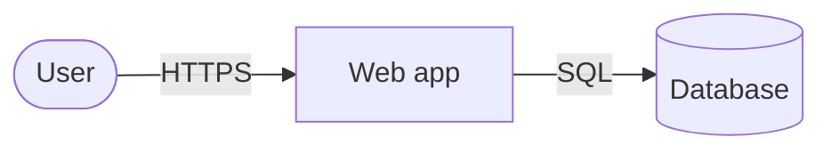

# Architecture — <Product name>

<!-- Write the page in the owner's language, headings included. Keep the Status line
     exactly as "Status: draft" or "Status: approved <YYYY-MM-DD>": hooks read it. -->

Status: draft

## Big picture

<In a few paragraphs: the parts of the product and how a typical request travels
through them.>

<How to read the diagram: what the boxes and arrows mean, and the path of one request.>

## Parts

| Part | Responsibility | Built with | Code | Page |
|---|---|---|---|---|
| <name> | <one line> | <technology and version> | `<folder>/` | [<name>](components/<part>.md) |

## Stack

| Layer | Choice | Why, in one line | Decision |
|---|---|---|---|
| <Language / framework / database / hosting> | <choice> | <reason> | [NNNN](decisions/NNNN-<slug>.md) |

## Data

<What is stored, where, who can see it, how it is backed up. Details: [data](data.md).>

## Outside services

| Service | What for | Cost | Whose account |
|---|---|---|---|
| <name> | <purpose> | <price or free tier> | <owner's / project's> |

## Run and check

<How the product starts locally and in production, and how changes are verified.
Exact commands live in AGENTS.md → Project commands; details in [operations](operations.md).>

## Decision log

| # | Date | Decision | Approved by | Status |
|---|---|---|---|---|
| [NNNN](decisions/NNNN-<slug>.md) | <date> | <what was chosen> | <owner / agent> | <accepted / superseded by NNNN> |
