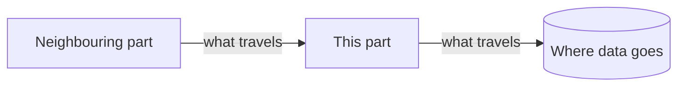

# <Part name>

<!-- One page per part of the product, in the owner's language. Delete sections that
     have nothing real to say. Mark the page "Planned — not built yet." until it is. -->

## What it does

<Two or three sentences: the responsibility of this part and why the product needs it.>

## Place in the architecture



<How to read the diagram: who calls this part, what it calls, and what travels along
each arrow.>

## How it works inside

<The main pieces of this part and how a request moves through them. Add a second
diagram if it helps. Explain each narrow term or add it to the glossary.>

## Key code

| File | What is there |
|---|---|
| `<path/to/file>` | <the role of this file; main functions or classes> |

```<language> title="<path/to/file>"
--8<-- "<path/to/file>:<region>"
```

<What this code does, line by line where it matters.>

## Data

<What this part reads and writes, and where. Link [data](../data.md) for details.>

## Tests

<Which tests cover this part, where they are, and how to run them.>

## Limitations and known debt

<Where this part stops being enough, and open items from Technical debt in TASKS.md.>
