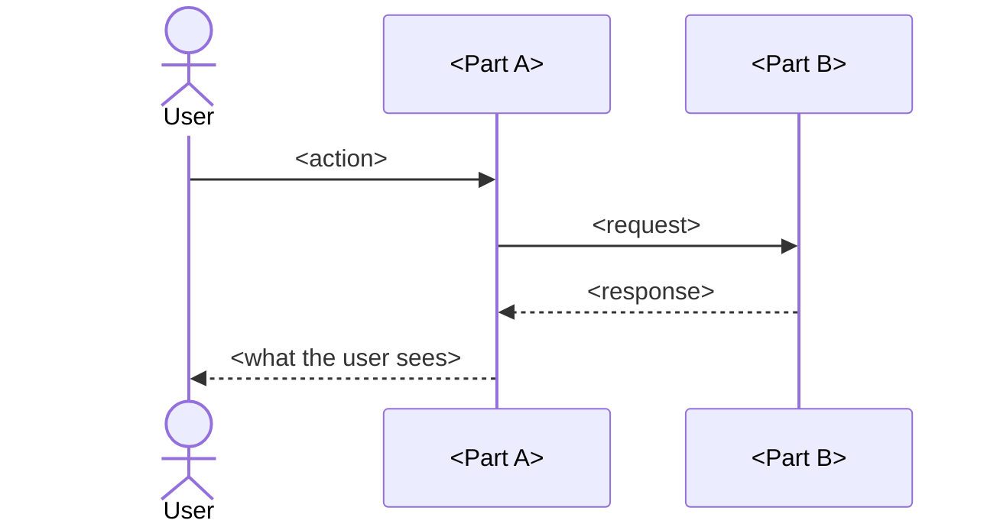

# <Scenario: what the user does>

<!-- One page per important user scenario, in the owner's language. -->

## In short

<What the user does, what they get, and which parts take part.>

## Sequence

<How to read the diagram: time flows downwards, solid arrows are requests, dashed
arrows are responses.>

## Step by step

1. <What happens>. Code: `<path/to/file>`, `<function>`.
2. <What happens>. Code: `<path/to/file>`, `<function>`.

## When something goes wrong

<What happens on the edge cases from PRODUCT.md: errors, timeouts, repeated actions —
and what the user sees.>

## Related

- <Links to the component pages and decisions involved.>
